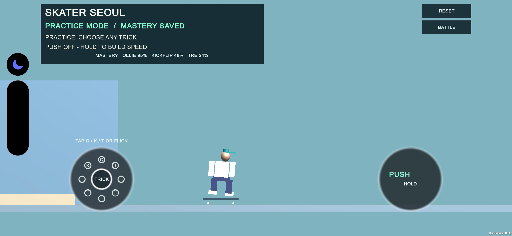
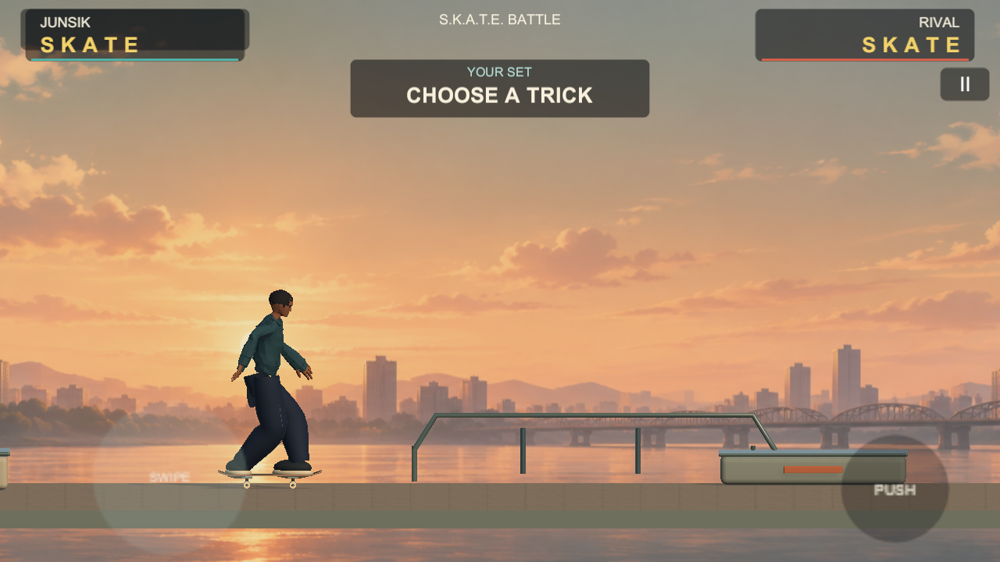
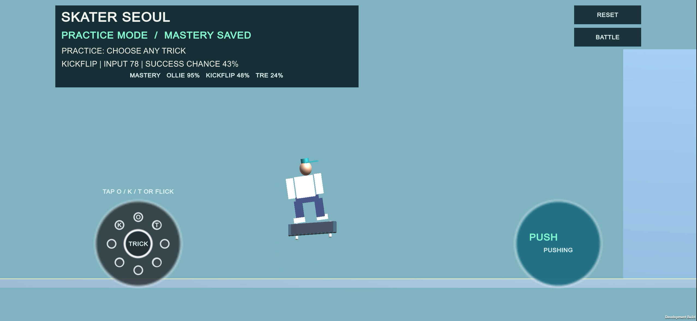
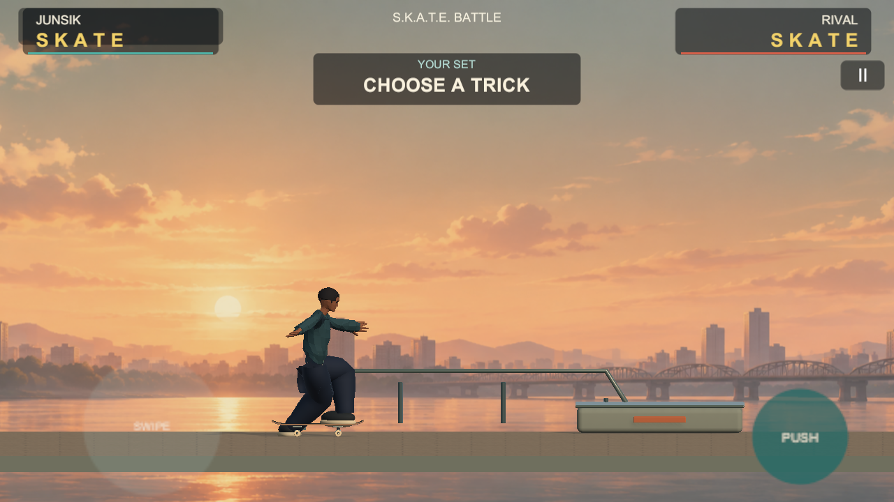
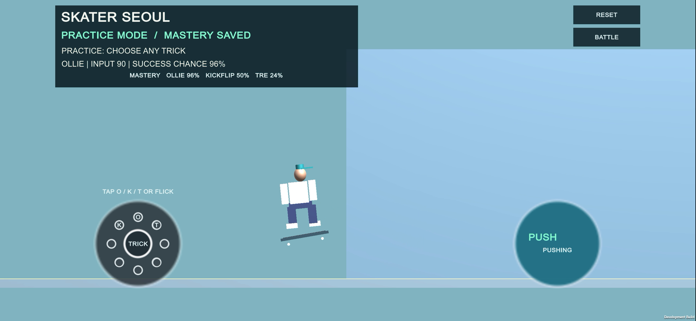
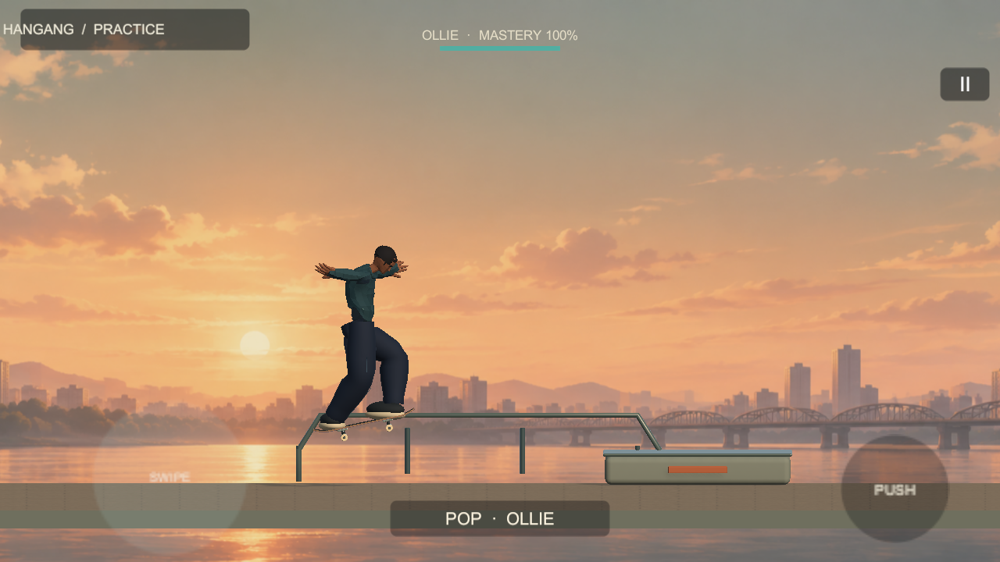
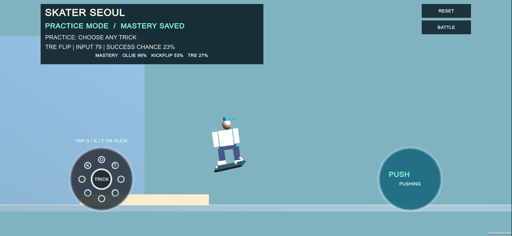

# SKATER SEOUL — 시각·물리 오버홀 QA 보고서

갱신일: 2026-10-23. 이 보고서는 현재 로컬 변경과 최신 저장된 QA 로그를 다시 대조한 결과다. `PASS`는 표기된 개별 확인만 통과했다는 뜻이며, 전체 PRD나 출시 준비 완료를 뜻하지 않는다.

## 범위와 기준

- 저장소 브랜치 `main`, 기준 커밋 `c274e7a` (`Initial commit: Skater Seoul source pack`). 현재 변경은 커밋되지 않은 로컬 작업 상태다.
- 실행 대상: `UnityProject/`, Unity `6000.3.10f1`, URP `17.3.0`, Input System `1.18.0`.
- 실행 씬: `UnityProject/Assets/SkaterSeoul/Scenes/SkaterSeoul_VisualSlice.unity` (Build Settings에 등록).
- 기준 영상에서 저장한 BEFORE 프레임은 2556×1180, 최신 AFTER 캡처는 1280×720이다. 해상도·구도가 같지 않아 화면 비교는 참고용이며 픽셀 단위 회귀 비교가 아니다.
- 참고 이미지는 빛·색감·카메라 분위기만 참고했다. Skate City의 모델·텍스처·코드·음원·게임 파일은 포함하지 않았다. 모델 계보와 라이선스는 [THIRD_PARTY_ASSETS.md](THIRD_PARTY_ASSETS.md)에 기록했다.
- 목표 시각 품질과 자산 형태의 상세 격차 평가는 [REALISM_GAP_REPORT_2026-10-23.md](REALISM_GAP_REPORT_2026-10-23.md)에 있다.
- 변경 경로 전체 목록은 [changed_files.txt](visual_overhaul/changed_files.txt)다. 이 목록은 현재 Git 로컬 상태로 다시 생성했다.
- 최신 실행 근거는 [playmode_results.txt](visual_overhaul/captures/playmode_results.txt), [r75 캡처 로그](visual_overhaul/captures/r75-landing-compression/iteration-3/capture.log), [시각 자산 검사 로그](visual_overhaul/captures/r75-landing-compression/iteration-3/validation.log)다. 35개 결과는 Unity Test Runner가 아니라 Editor Play Mode 캡처 프로브의 자체 QA 로그다. 이번 보고서 갱신 과정에서 게임 검사를 다시 실행하지는 않았다.

## Before / After 화면

| 비교 | BEFORE | AFTER | 관찰 |
|---|---|---|---|
| 주행 화면 |  |  | 서울 한강 배경, 보드·캐릭터·HUD가 들어간 3D 화면. 단, 파일명과 달리 캡처 화면에는 자유 주행이 아니라 S.K.A.T.E. Battle의 `Choose a Trick` 상태가 보인다. |
| PUSH 입력 |  |  | PUSH 버튼과 푸시 포즈가 보인다. 이 캡처도 Battle HUD 상태다. 실기기 터치 확인은 아니다. |
| Ollie / 장애물 |  |  | 별도 Play Mode 검사에서 충돌체가 있는 ledge를 넘고 착지했다. 화면 비교의 촬영 조건은 서로 다르다. |
| Tre Flip |  |  | 모션 단계 캡처다. 연속 영상이나 전문 애니메이션 리뷰를 대신하지 않는다. |

추가 캡처: [연습 화면](visual_overhaul/captures/05_battle_player_set.png), [배틀 화면](visual_overhaul/captures/06_battle_bot_match.png), [HUD 없는 환경](visual_overhaul/captures/environment/hud_off.png), [보드 3/4 뷰](visual_overhaul/captures/board/04_board_3q.png), [보드 아랫면](visual_overhaul/captures/board/05_board_underside.png), [장애물 접근](visual_overhaul/captures/07_obstacle_approach.png), [장애물 착지](visual_overhaul/captures/09_obstacle_landing.png), [모션 캡처 인덱스](visual_overhaul/captures/motion/index.html).

**캡처 이름 주의:** 일부 최상위 파일명과 이미지의 실제 게임 상태가 일치하지 않는다. `01`·`02`에는 Battle의 `Choose a Trick`, `04`에는 `Match Ollie`, `05_battle_player_set.png`에는 Hangang Practice가 표시된다. 실제 상태는 이미지 HUD를 기준으로 읽어야 한다. 캡처 자동화가 저장된 모드를 초기화하는지 고치고 다시 촬영할 필요가 있다.

## P0–P5 진행 상태

| 단계 | 상태 | 현재 근거와 미완료 항목 |
|---|---|---|
| P0 — 기준 상태·캡처 | **부분 PASS** | 기준 녹화 프레임과 현재 3D 화면을 저장했다. 화면 크기와 촬영 상태가 일치하지 않는다. |
| P1 — 보드 주행 | **부분 완료; 휠 롤률 FAIL** | 평지 10초 PUSH/코스팅과 4개 프로브는 검사했다. 테스트가 사용한 롤 반경 0.039m와 생성 FBX 휠 반경 0.027m가 달라 실제 렌더 휠 회전은 주행 거리보다 약 30.8% 부족하다. 후진·브레이크·경사·기기 검증도 남았다. |
| P2 — 라이더·트릭 | **부분 완료, 검사 1건 실패** | Humanoid 라이더, 발 IK, PUSH·착지 모션과 Ollie/Kickflip/Tre Flip, 세 실패 포즈를 구현했다. 킥플립 착지 무릎 굴곡 assertion이 기준보다 낮다. |
| P3 — 서울 환경·카메라 | **부분 완료** | 자체 수정한 라이더 FBX, 보드·한강변 세트 FBX, 한강 노을 배경, 콘크리트 PBR 텍스처와 장애물을 적용했다. 라이더의 로우폴리 실루엣과 배경·소품의 디테일은 상용 수준 목표에 미달한다. |
| P4 — HUD·조작감 | **부분 완료** | 런타임 HUD, 배틀 턴/문자, PUSH·제스처 UI가 있다. 화면 캡처의 모드 라벨 불일치, 실제 멀티터치·노치 안전영역·효과음·햅틱 확인은 남았다. |
| P5 — QA·전달 | **부분 완료, 자체 QA 34/35** | Editor Play Mode 캡처 프로브 로그에 34 PASS, 1 FAIL이 있다. Unity Test Runner 테스트 모음이 실행된 결과는 아니다. 시각 자산 정적 검사는 PASS다. iOS 빌드·실기기·발열/성능 검사는 실행하지 않았다. |

## 승인 게이트 G00–G11

| 게이트 | 상태 | 증거 / 제한 |
|---|---|---|
| G00 실제 Unity 타깃 | **PASS** | Unity 6000.3.10f1, URP 17.3.0 프로젝트·씬이 있고 Build Settings에 씬이 등록됐다. |
| G01 그래픽 | **부분 완료** | 큐브 월드 대신 캐릭터·보드·한강변 3D 세트·질감·그림자가 적용됐다. 기준/현재 캡처는 동일 촬영 조건이 아니며 라이더는 아직 로우폴리다. |
| G02 바퀴 회전 | **FAIL — 메시 기준 롤률** | 기존 47.93m 일치값은 회전각에 설정 반경 0.039m를 곱해 Rigidbody 이동과 비교한 계산 일치다. Blender 메시 휠 반경은 0.027m이고 FBX `globalScale`은 1이므로, 같은 회전각의 실제 메시 표면 환산 거리는 약 33.18m다(약 30.8% 부족). 반경을 통일하고 다시 측정해야 한다. |
| G03 접지 | **부분 완료** | 4개 프로브는 평지에서 지면을 찾았다. 기존 최대 간극 0.0080m는 잘못 설정된 0.039m 반경 기준이며, 메시 반경 0.027m 기준 간극은 약 0.004m로 추산된다. 두 값 모두 현재 0.01m 지지 허용치 안이지만, 경사·ledge와 기기 접촉은 미검증이다. |
| G04 PUSH/코스팅 | **부분 완료** | 10초 검사에서 47.98m 이동, PUSH 해제 시 6.52m/s, 측정 종료 시 2.61m/s. 착지 직후 속도 연속성과 전체 10초 게임 영상은 확인하지 않았다. |
| G05 트릭 동작 | **FAIL — 킥플립 착지 assertion 1건** | 60fps, 20프레임(0.333초) 킥플립 착지 영상과 자세 캡처가 있다. 발 앵커·골반 압축·복구 검사는 통과했지만 양 무릎 굴곡 변화는 17°/17°로 요구 범위 20–35°보다 각각 3° 낮았다. |
| G06 착지 판정 | **통과(검사 경로)** | 세 트릭의 제어 착지, 1회 시도/확률 추첨/성장 기록과 세 실패 유형을 검사했다. 모든 실기기 상황을 대표하지 않는다. |
| G07 HUD/레이아웃 | **부분 완료** | 1280×720 캡처가 있다. 16:9 외 화면 비율, 노치/안전영역, 30회 실제 양손 입력 추적은 미검증이다. |
| G08 S.K.A.T.E./성장 | **부분 완료** | v13 진행 데이터의 39개 안정 ID와 플레이어 세트 후 봇 매치 전환을 검사했다. 전체 5글자 경기 종료, 재실행 저장, 기존 설치본 세이브 이전은 미검증이다. |
| G09 성능 | **NOT RUN** | iPhone 15 Pro 및 중급 기기 프레임 타임·메모리·10분 발열 프로파일이 없다. |
| G10 아트·라이선스 | **PASS(기록된 에셋)** | Quaternius/Kenney/Poly Haven 출처와 CC0 라이선스, 프로젝트 자체 생성 에셋을 [에셋 목록](THIRD_PARTY_ASSETS.md)에 기록했다. |
| G11 결과 보고 | **부분 완료** | 기준/현재 스크린샷, 모션 스틸, 0.333초 킥플립 60fps 영상과 검사 로그가 있다. 10초 이상 연속 게임 영상과 일치 구도 4쌍은 없다. |

## 최신 측정 결과

- 자체 Editor Play Mode QA 로그: **34 PASS / 1 FAIL**. 이는 Unity Test Runner 기반 테스트 모음이 아니다. 프로젝트 `Assets`에는 Unity 테스트용 `Tests` 디렉터리나 `.asmdef`가 확인되지 않았다. 유일한 assertion 실패는 킥플립 접촉 뒤 양 무릎이 각각 20–35° 더 굽혀져야 하는데 실제 변화가 17°/17°였다는 것이다. 전체 로그는 [playmode_results.txt](visual_overhaul/captures/playmode_results.txt)에 있다.
- PUSH/코스팅 10초: 이동 47.98m, 해제 시 6.52m/s, 코스팅 종료 시 2.61m/s.
- 휠 회전 샘플 구간: 물리 스텝 16→521에서 검사 코드가 계산한 값은 47.93m다. 이는 회전각×설정 반경 0.039m이며, 실제 생성 메시 반경 0.027m로 환산하면 약 33.18m다. 따라서 종전의 `바퀴 호 길이=바디 이동` PASS는 메시 기준 시각 롤률을 검증하지 못한다.
- 지면 지지: 네 프로브가 지면을 찾고 설정 반경 기준 최대 간극은 0.0080m였다. 생성 메시 기준 실제 간극 추산은 약 0.004m다.
- 착지 자세의 나머지 킥플립 측정: 접촉 프레임 14ms 이내, 골반 압축 0.108m, 두 발 보드 앵커 오차 최대 0.006m, 260ms 시점 골반 복귀 오차 0.012m. 무릎 검사와 별개로 기록한다.
- 장애물 Ollie: 콜라이더가 있는 ledge를 넘고 X=5.80에서 정상 착지했다.
- 저장/배틀: 레거시 v13 스키마와 39개 ID, 트릭별 성장 기록 1회, 플레이어 세트에서 봇 매치로의 전이를 검사했다. 전체 경기 흐름은 아직 연결·검증되지 않았다.
- 60fps 영상은 Kickflip 착지 구간 20프레임, 1280×720, 0.333초다: [kickflip_landing_60fps.mp4](visual_overhaul/captures/r75-landing-compression/iteration-3/kickflip_landing_60fps.mp4). 세 트릭 전체를 담은 영상이나 10초 주행 영상은 아니다.
- 최신 시각 자산 검사 로그는 `SKATER SEOUL: visual slice asset checks PASS`를 기록한다. 자체 Editor 캡처 QA는 34/35다. 둘 다 사람 눈의 전체 품질 승인은 아니다.

## 우선 개선 사항

1. **킥플립 착지:** 접촉 후 0.10초 압축 구간에서 양 무릎 굴곡을 각각 20° 이상으로 만들고, 발 앵커 오차 0.02m 이하와 골반 복귀 기준을 함께 유지하며 캡처 테스트를 다시 실행한다.
2. **캡처 자동화:** 매 실행 전 Practice/Battle 모드를 명시적으로 설정하고, 실제 화면 상태와 일치하도록 캡처 이름을 정한다. 자유 주행·PUSH·코스팅 화면을 다시 저장한다.
3. **실제 기기 검증:** iOS 빌드 설치 후 터치, 안전영역, 화면 방향/비율, 바퀴·경사·후진, 프레임 타임과 발열을 측정한다.
4. **비주얼 품질:** 라이더는 현재 커스텀 의상/리그를 적용했지만 실루엣이 단순하다. 표정·의상 주름·체형과 배경 건축/수목 디테일, 그림자와 원거리 선명도를 개선한다.
5. **게임 완성도:** 3개 트릭 외 39개 카탈로그 플레이, 전체 5글자 매치 종료, 커리어/미션 UI, 앱 재실행 저장 및 실제 구버전 세이브 이전을 연결하고 검증한다.

## 씬 실행

Unity 6000.3.10f1에서 `UnityProject/`를 열고 `Assets/SkaterSeoul/Scenes/SkaterSeoul_VisualSlice.unity`를 실행한다. Editor 메뉴 `Tools > SKATER SEOUL > 1 - Build Seoul Visual Slice`는 씬을 다시 생성한다. 저장하지 않은 씬을 덮지 않도록 재생성 전에 현재 씬 변경 사항을 확인한다.

## NOT RUN / BLOCKED

- **NOT RUN:** iOS/Xcode 빌드·설치, iPhone/iPad 게임플레이, 실제 터치·노치 안전영역, 19.5:9 레이아웃, 역주행·브레이크·경사 물리, 30/60/120fps 하드웨어 비교, SFX·햅틱, 성능·발열, 전체 매치 종료, 앱 재실행 세이브와 실제 이전본 세이브.
- **NOT RUN:** 10초 이상 연속 플레이 영상. 저장된 60fps 영상은 Kickflip 착지 0.333초 구간이다.
- **NOT RUN:** Unity Test Runner 기반 EditMode/PlayMode 테스트 모음. 현재 프로젝트에는 이를 구성한 테스트 디렉터리/어셈블리가 발견되지 않았으며, 보고된 34/35는 커스텀 Editor 캡처 프로브 로그다.
- **BLOCKED:** 실기기 프레임 페이싱·발열·물리 터치 동작은 기기 실행 증거가 없어 판단할 수 없다. Editor 캡처나 컴파일 결과로 대체하지 않는다.
